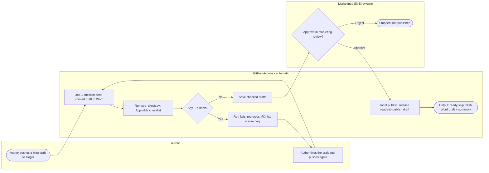

# Week 1 - Friday: My CI/CD process (Appnable blog draft pipeline)

## What I mapped

My own process is the **Appnable Blog Writing skill** I built. Its final check, `seo_check.py`, tests a blog draft against Marketing's Appnable Blog Writing Guidelines. For Friday I turned that into a real CI/CD pipeline with GitHub Actions, so a blog draft moves from **push → test → review → publish** the same way code does.

- Workflow file: [`.github/workflows/blog-pipeline.yml`](../.github/workflows/blog-pipeline.yml)
- Test script: [`scripts/check_blogs.sh`](../scripts/check_blogs.sh), which runs [`scripts/seo_check.py`](../scripts/seo_check.py)
- Sample draft (test data only): [`blogs/client-onboarding-automation.md`](../blogs/client-onboarding-automation.md)
- Runs: [Actions tab](https://github.com/teslimtobi/internal-automations-training/actions)

## It runs: two real pipeline runs

| Run | What I pushed | Result |
| --- | --- | --- |
| [#1](https://github.com/teslimtobi/internal-automations-training/actions/runs/40305508634) | Draft v1 with 2 deliberate faults | ❌ Failed at the checklist test: "0 link(s) to an Appnable Solution page" and "US spellings: organize". Review and publish were skipped |
| [#2](https://github.com/teslimtobi/internal-automations-training/actions/runs/40306028491) | Fixed draft | ✅ Checklist passed (0 FIX items) → paused for review → approved → published |

## The four parts of the flow

| Part | In this pipeline |
| --- | --- |
| **Trigger** | A push that adds or changes a file in `blogs/` (or a manual run) |
| **Steps** | Get the code → set up Python → install pandoc and python-docx → convert the draft to Word → run the Appnable checklist → save the results |
| **Decision points** | 1. Any FIX items? (No → continue, Yes → run fails) 2. Reviewer approves? (Yes → publish, No → stop) |
| **Output** | A "ready-to-publish" Word draft saved on the run, plus a summary of what passed |

## Flowchart

## Who owns each step

| Step | Owner | How it starts |
| --- | --- | --- |
| Push the draft | Author | Author's own action |
| Convert and test the draft | GitHub Actions | Automatic, on every push to `blogs/` |
| Decide pass/fail | `seo_check.py` | Automatic: 0 FIX items = pass |
| Fix a failed draft | Author | Red cross plus the FIX list on the run |
| Approve for publishing | Named reviewer (required reviewer on the `marketing-review` environment) | GitHub waits and notifies the reviewer |
| Release the draft | GitHub Actions | Automatic, only after approval |
| Upload to the website and log the keyword | Author | "Next" line in the publish summary |

## Compared with Scenario A: which has clearer ownership?

**The pipeline has much clearer ownership.**

| | Blog draft pipeline | Scenario A onboarding |
| --- | --- | --- |
| Trigger | A push always starts it | Depends on whose inbox the contract lands in |
| Handoffs | Automatic: each job starts when the previous one passes | Memory: Sales → Ada → Kemi |
| Owner per step | Every step has an owner (person or system) | 3 steps have no owner |
| Gate | Failed test or no approval = nothing moves | Nothing stops a missed step |
| Visibility | Every run, pass or fail, is logged in the Actions tab | Nobody sees the folder was never made |
| When something is missed | The run goes red and tells the author what to fix | The client waits (9 days last month) |

**Why:** in the pipeline, the rules are written down in one file, so the system does the remembering. In Scenario A, the process lives in people's heads. The pipeline also shows the fix for Scenario A: an automatic trigger when the contract arrives, a named owner for every step, and a gate so the welcome email can't go out until the folder exists.

**Where the pipeline still relies on people:** the reviewer has to act on the approval request, and the final upload to the website and the content tracker update are still manual. Those are the next things to automate.
