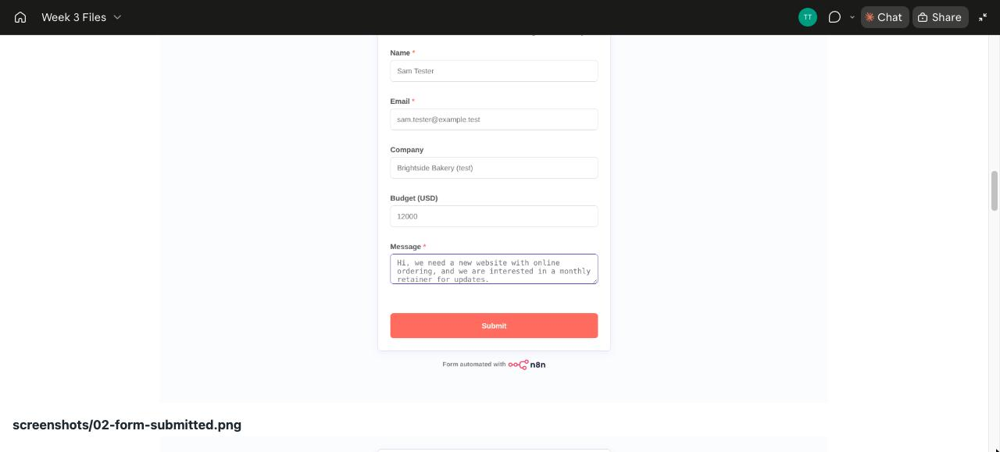
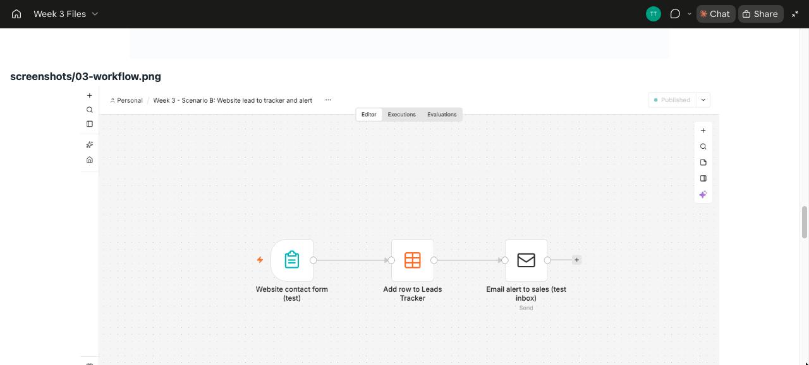
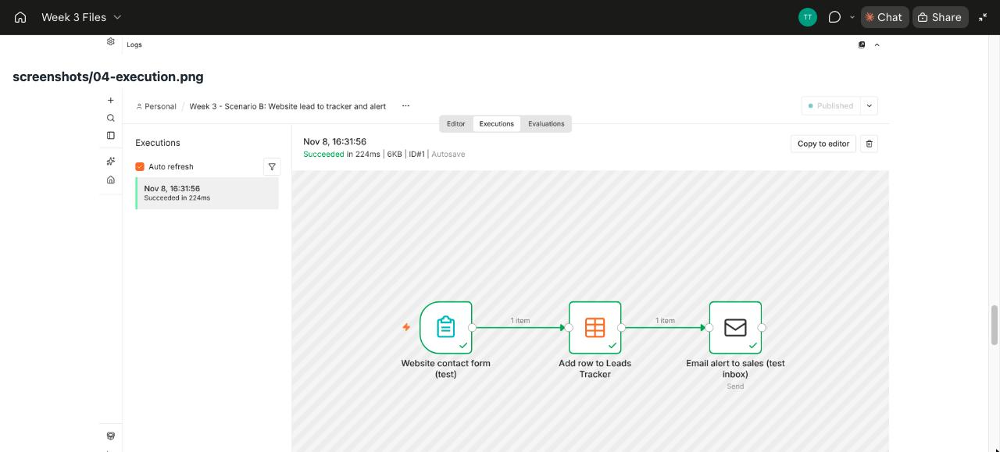
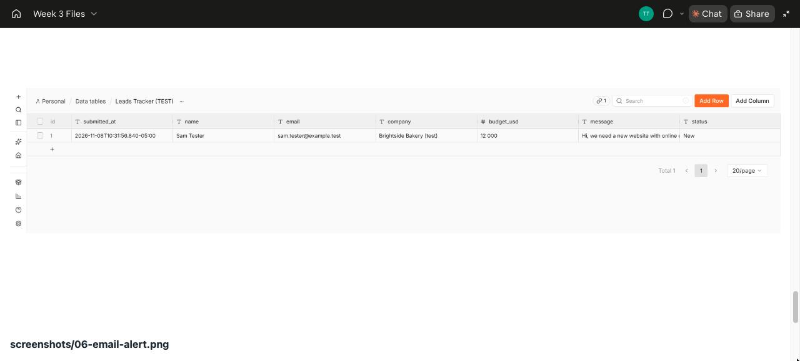
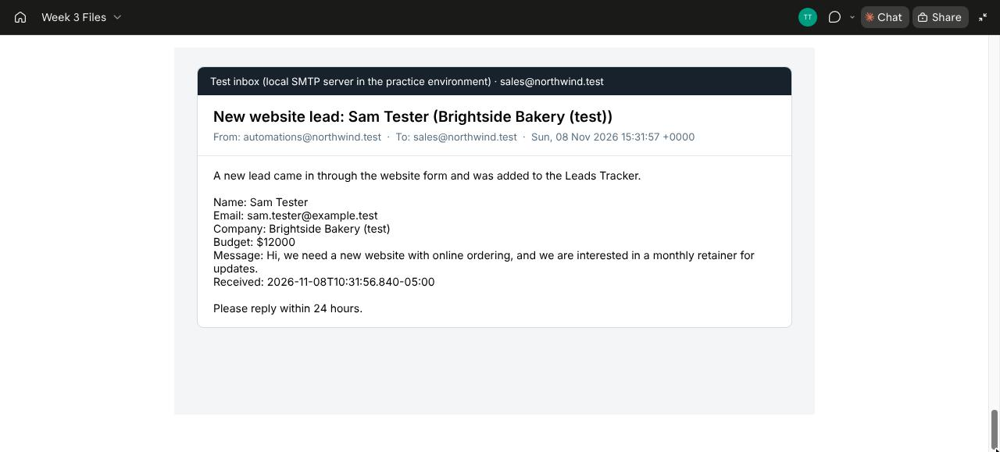

# Week 3: First Automation Platform (Scenario B)

**Goal:** build the same simple automation twice: once in **n8n**, once in **Power Automate**.

**Scenario B:** website leads land in a shared inbox, and Tobi copies them into the leads tracker by hand. Leads sometimes wait 3 days for a reply.

**The automation:** when a lead submits the contact form, it's added to the leads tracker automatically and sales gets an alert straight away.

All builds use **test data and test addresses only** (`@example.test`, `@northwind.test`). Nothing touches real client data.

## Files

| Day | File | What it is |
| --- | --- | --- |
| Mon | [monday-tool-notes.md](monday-tool-notes.md) | How n8n, Power Automate, Zapier and Make name triggers and actions |
| Tue | [flow-map.png](flow-map.png) | The 3-box map of the flow |
| Wed | [n8n/scenario-b-lead-workflow.json](n8n/scenario-b-lead-workflow.json) + [screenshots](screenshots/) | The n8n build and its successful run |
| Thu | [power-automate-build-guide.md](power-automate-build-guide.md) | Step-by-step Power Automate build |
| Fri | [friday-tool-comparison.md](friday-tool-comparison.md) | 5-line comparison and self-check answers |

## Tuesday: the flow map

## Wednesday: the n8n build

**Where it runs:** n8n self-hosted (free, Community Edition 2.44.5) in a sandbox practice environment.

| Box | n8n node | What it does |
| --- | --- | --- |
| 1 | **n8n Form Trigger** "Website contact form (test)" | Shows a contact form with Name, Email, Company, Budget (USD) and Message. Submitting it starts the workflow. |
| 2 | **Data Table → Insert row** "Add row to Leads Tracker" | Adds the lead to the *Leads Tracker (TEST)* table with status *New*. |
| 3 | **Send Email** "Email alert to sales (test inbox)" | Emails `sales@northwind.test` with the lead's details, through a local test mail server. |

**Why a data table and a test inbox, not Excel and Teams?** Connecting self-hosted n8n to Microsoft 365 needs an Azure app registration. That's outside a free practice setup. n8n's data table works like a SharePoint list or Excel table, and the local test inbox proves the alert sends. The Power Automate build uses the real Microsoft apps.

### Successful run (test lead: "Sam Tester", Brightside Bakery, $12,000)

1. The test form, filled in:

   

2. The workflow (trigger → add row → email):

   

3. **The successful execution.** All 3 nodes show green ticks, "Succeeded in 224ms":

   

4. The new row in the Leads Tracker:

   

5. The alert email received in the test inbox:

   

**To reuse it:** in n8n, go to **Workflows → Import from file** and choose `n8n/scenario-b-lead-workflow.json`. Then recreate the data table and pick your own email credential.

## Thursday: the Power Automate build

Same 3 boxes: **Microsoft Forms → Excel Online "Add a row into a table" → Teams "Post message"**. The step-by-step guide is in [power-automate-build-guide.md](power-automate-build-guide.md). The run screenshot will be added after the test run in Appnable's Microsoft 365.

## Friday: comparison

See [friday-tool-comparison.md](friday-tool-comparison.md). **Pick for this flow: Power Automate.** Everything Northwind uses is already in Microsoft 365.
