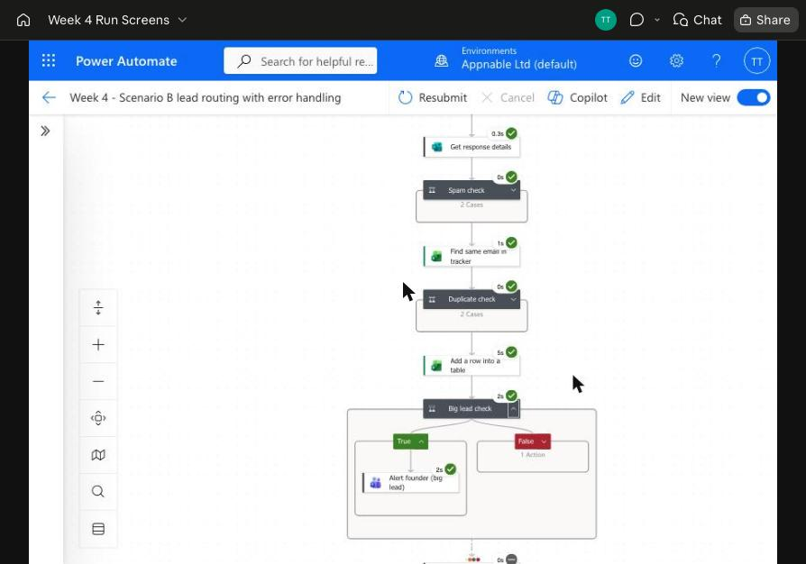
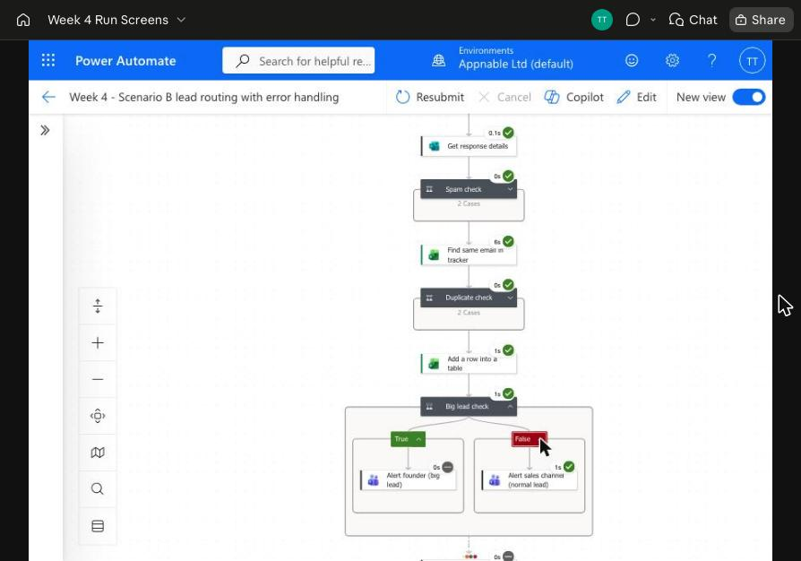
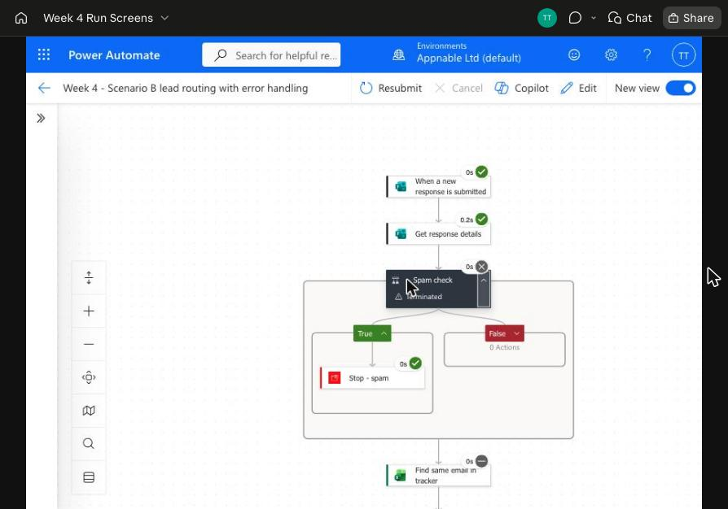
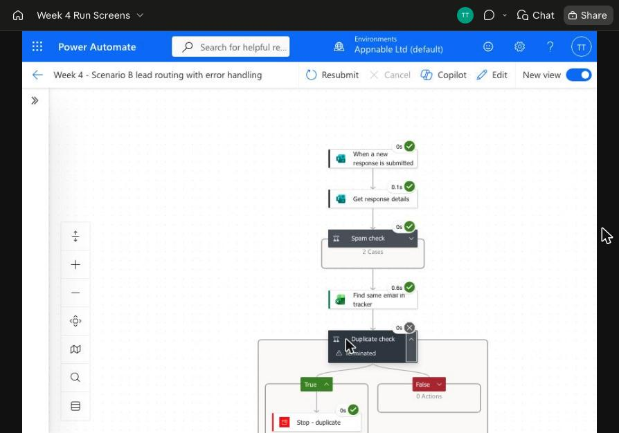
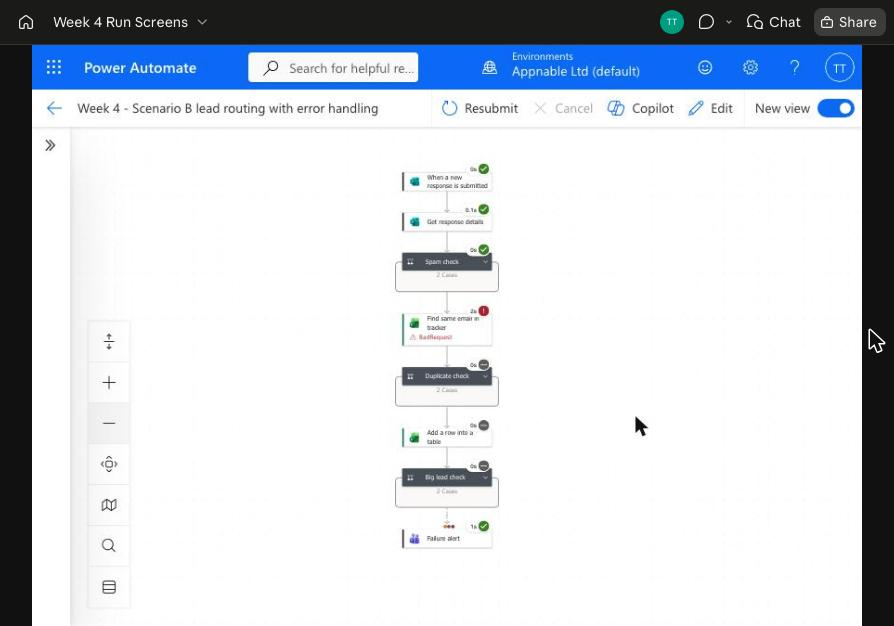

# Week 4: Conditionals, branching and error handling (Scenario B)

**Goal:** make the Week 3 lead flow handle more than the happy path. It should send big leads to the right person, ignore spam and duplicates, and **tell someone when it fails**.

**Tool:** Power Automate (Appnable Microsoft 365). Flow name: `Week 4 - Scenario B lead routing with error handling`.

All tests used **test data and `@example.test` addresses only**. Every alert goes to my own Teams chat with the Flow bot, labelled with the person it would go to in real life (founder or sales). No real person or client data is involved.

## Files

| Day | File | What it is |
| --- | --- | --- |
| Mon | [monday-failure-notes.md](monday-failure-notes.md) | Key ideas (IF / Paths / error handling) and 3 ways the flow could fail |
| Tue–Thu | [build-guide.md](build-guide.md) | Click-by-click: the $10k/"retainer" branch, the spam filter, the duplicate check and the failure alert |
| Fri | [break-log.md](break-log.md) | 3 deliberate breaks, what happened, and the fixes |
| Fri | [self-check.md](self-check.md) | Answers to the Week 4 self-check questions |
| All | [screenshots/](screenshots/) | Run screenshots for every test |

## The Week 4 flow

```
Form submitted
 → Get response details
 → Spam check ─ yes → Stop (Succeeded, nothing added, no alert)
 → Find same email in tracker
 → Duplicate check ─ yes → Stop (Succeeded, no second row)
 → Add a row into a table
 → Big lead check (budget > $10,000 OR message mentions "retainer")
      ├ True  → Alert founder (big lead)
      └ False → Alert sales channel (normal lead)
 → Failure alert  (runs ONLY if an earlier step failed, was skipped or timed out)
```

| Step | Power Automate action | What it does |
| --- | --- | --- |
| Spam check | Condition | Message contains `http`, `www.`, `crypto`, `seo services` or `casino` → Terminate (Succeeded) |
| Find same email in tracker | Excel: *List rows present in a table*, Filter Query `Email eq '<email>'` | Looks for the email in the Leads table |
| Duplicate check | Condition: `greater(length(rows), 0)` | Email already there → Terminate (Succeeded) |
| Big lead check | Condition: `or(budget > 10000, message contains "retainer")` | Picks founder or sales. A blank budget counts as 0. |
| Failure alert | Teams message, **Run after = has failed / is skipped / has timed out** on *Big lead check* | Says which steps failed, with a link to the run |

## Test results (12 Nov 2026)

| # | Test lead | Expected | Result | Screenshot |
| --- | --- | --- | --- | --- |
| 1 | Riley Big, $15,000, mentions "retainer" | Row added, **founder** alerted | ✅ Founder alert sent, failure alert skipped | [01](screenshots/01-big-lead-run.png) |
| 2 | Jo Small, **blank budget** | Row added, **sales** alerted | ✅ Sales alert sent (blank budget treated as 0) | [02](screenshots/02-normal-lead-run.png) |
| 3 | Spam Bot, "Cheap SEO services … http://…" | Stopped, nothing added | ✅ Stopped at Spam check in 0.4 s | [03](screenshots/03-spam-stopped.png) |
| 4 | Riley Big again (same email) | Stopped, no second row | ✅ Stopped at Duplicate check in 0.8 s | [04](screenshots/04-duplicate-stopped.png) |
| 5 | Break test: tracker lookup broken on purpose | Failure alert sent | ✅ Lookup failed (BadRequest), later steps skipped, **Failure alert sent** | [05](screenshots/05-failure-alert-run.png) |

### 1. Big lead → founder



### 2. Normal lead (blank budget) → sales



### 3. Spam stopped



### 4. Duplicate stopped



### 5. Failure alert (deliverable screenshot)


